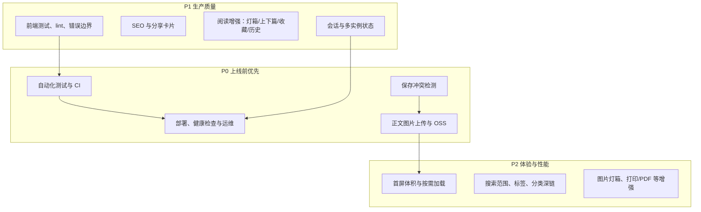
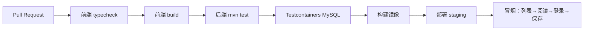
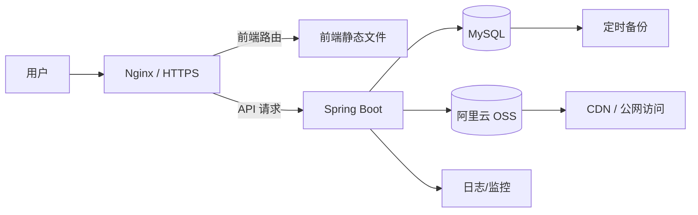
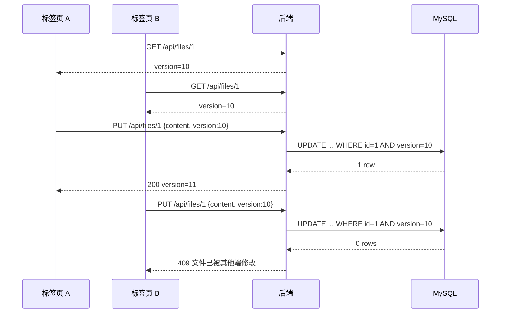
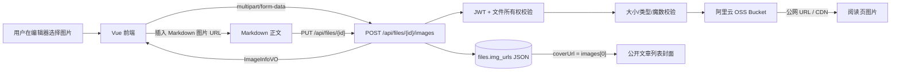
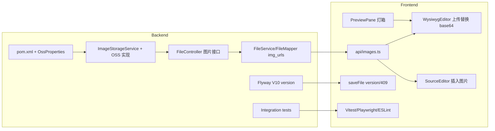
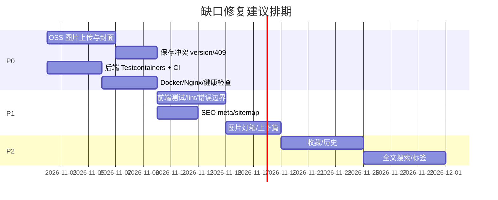

# 主要缺口与改造方案（可视化版）

> 更新时间：2026-11-01
> 适用范围：`frontend/` + `backend/`
> 目标：把当前 MVP 阅读器距离“稳定使用/上线”的主要缺口拆成可执行改造项，并给出具体落点。
> 特别说明：图片方案按“使用阿里云 OSS 存储”设计。

---

## 1. 缺口总览



### 1.1 优先级矩阵

| ID | 缺口 | 当前状态 | 影响 | 成本 | 优先级 |
|---|---|---|---|---|---|
| G1 | 自动化测试与 CI | 后端测试代码存在但依赖本机 MySQL；前端无测试 | 无法证明回归安全，交付不可复现 | 中 | P0 |
| G2 | 部署与运维 | 只有 Nginx 示例，无 Docker/CI/健康检查/备份监控 | 公网稳定性与恢复能力不足 | 中 | P0 |
| G3 | 保存冲突检测 | 整篇覆盖，没有版本号/条件更新 | 多标签页、多设备互相覆盖 | 低-中 | P0 |
| G4 | 正文图片与 OSS | 完全没有上传链路，图片以 base64 写入正文 | 正文超限、封面为空、无法复用图片 | 中 | P0 |
| G5 | 会话与多实例状态 | 生产 Token 7 天、localStorage；限流/验证码在内存 | 安全窗口大，扩容后行为不一致 | 中 | P1 |
| G6 | SEO 与分享 | 只有动态 title，无 description/OG/canonical/sitemap | 公开文章难以被搜索和分享 | 中 | P1 |
| G7 | 阅读增强 | 无图片灯箱、上下篇、收藏、历史 | 阅读产品完成度不足 | 中 | P1-P2 |
| G8 | 前端工程化 | 无前端测试、无 lint、无全局错误边界 | 迭代风险高，线上错误不可见 | 中 | P1 |
| G9 | 搜索与分类边界 | 只有标题搜索；分类深链首次加载可能不带筛选 | 内容多了以后检索能力不足 | 低 | P2 |

---

## 2. G1：自动化测试与 CI

### 2.1 具体缺失

- 后端已有 25 个集成测试，但 `application-test.yml` 直接连接本机 MySQL：
  - `localhost:3306/mdreader_test`
  - `root/1234`
  - 本机 MySQL 未启动时，25 个测试全部报 `Connection refused`。
- 前端 `package.json` 只有 `dev/build/preview/typecheck`，没有：
  - `vitest` / `@vue/test-utils`
  - Playwright
  - ESLint
  - 测试脚本
- 没有 CI workflow，无法在提交/合并时自动执行 typecheck、build、后端测试。

### 2.2 建议改造



落点：

- `.github/workflows/ci.yml`（或 GitLab CI）
- `frontend/package.json` 增加 `test`、`test:e2e`、`lint`
- `frontend/vitest.config.ts`、`frontend/playwright.config.ts`
- `backend/pom.xml` 增加 Testcontainers 依赖
- `backend/src/test/resources/application-test.yml` 改为 Testcontainers 动态数据源，或使用 CI service
- `backend/src/test/java/com/mdreader/integration/*` 保留并扩展

验收：

- [ ] 全新环境不依赖本机 MySQL，`mvn test` 可跑通。
- [ ] PR 自动执行前端 typecheck/build、后端测试。
- [ ] 至少覆盖：登录、公开/私有文件、管理端权限、文件重名、保存冲突、图片上传。
- [ ] 前端至少覆盖：Markdown 清洗、阅读页加载、登录后保存、图片上传失败提示。

---

## 3. G2：部署与运维

### 3.1 具体缺失

- 只有 `docs/frontend/reader-deploy-2026-10-31.md` 中的 Nginx 示例。
- 没有：
  - Dockerfile / docker-compose
  - Actuator `/actuator/health`
  - 优雅停机
  - 数据库备份脚本
  - 日志采集/错误监控
  - 前端 CI 构建与发布
- `uploads/` 仍是本地目录，容器重建会丢头像；正文图片如果也走本地会更严重。
- 生产 profile 默认仍可能落到 `local`，缺少关键环境变量时没有 fail-fast。

### 3.2 建议改造



落点：

- 根目录 `Dockerfile`、`docker-compose.yml`
- `frontend/Dockerfile` 或 Nginx 静态站点配置
- `backend/Dockerfile`
- `backend/src/main/resources/application-prod.yml`：
  - `management.endpoints.web.exposure.include=health,info`
  - `server.shutdown=graceful`
  - `spring.lifecycle.timeout-per-shutdown-phase=30s`
- 生产环境变量清单：
  - `SPRING_PROFILES_ACTIVE=prod`
  - `DB_HOST/DB_PORT/DB_NAME/DB_USERNAME/DB_PASSWORD`
  - `JWT_SECRET`
  - `CORS_ALLOWED_ORIGINS`
  - `OSS_*`
- `docs/frontend/reader-deploy-2026-10-31.md` 补充 HTTPS、缓存、备份、监控。

验收：

- [ ] `docker compose up` 可启动前端、后端、MySQL。
- [ ] `/actuator/health` 返回 UP。
- [ ] 容器重启后上传文件不丢。
- [ ] 生产缺少 `JWT_SECRET`/`DB_*` 时启动失败。
- [ ] 有数据库备份与恢复演练记录。

---

## 4. G3：保存冲突检测

### 4.1 具体缺失

- `PUT /api/files/{id}` 接收整篇 `content` 直接覆盖。
- `UpdateFileDTO` 没有版本号/`updatedAt` 字段。
- 前端 `saveFile()` 只处理 404，不处理 409。
- 两个标签页同时编辑时，后者会静默覆盖前者。

### 4.2 建议改造



落点：

- Flyway 新增 `V10__add_file_version.sql`：`files.version BIGINT NOT NULL DEFAULT 0`
- `UpdateFileDTO` 增加 `version`
- `FileMapper.updateFile` 增加 `AND version = #{version}`，更新时 `version = version + 1`
- `FileServiceImpl.updateCurrentUserFile` 检查受影响行数，0 行返回 409
- `FileDetailVO` / `FileVO` 增加 `version`
- 前端 `saveFile()` 携带 `version`；409 时提示“重新加载云端版本”
- 阅读页不受影响

验收：

- [ ] 两个标签页基于同一版本保存，第二个返回 409。
- [ ] 前端能提示并重新拉取正文。
- [ ] 自动保存不会把 409 静默吞掉。

---

## 5. G4：正文图片与 OSS（重点）

### 5.1 当前到底缺什么

当前项目没有任何“正文图片上传”链路：

- 后端没有 OSS 依赖、配置、上传接口和图片存储服务。
- `CreateFileDTO`、`UpdateFileDTO` 都没有 `images` 字段。
- `FileMapper.updateFile` 没有更新 `img_urls`。
- `FileServiceImpl` 创建/保存时从未写入 `imgUrls`。
- 因此 `FileVO.coverUrl` 虽然存在，但公开列表实际上拿不到封面。
- `ImageInfoVO` 和 `files.img_urls` 字段已经存在，属于“预埋但未使用”。
- 前端 `WysiwygEditor` 仍用 `FileReader.readAsDataURL()` 把图片写成 base64：
  - `MAX_IMAGE_SIZE = 4 * 1024 * 1024`
  - `paste_data_images: true`
  - 多张图片叠加后可能超过后端 10 MB 正文限制。
- 没有图片删除、替换、alt 文本、失败重试、上传进度。
- 阅读页没有图片灯箱；列表页封面依赖 `coverUrl`。
- 头像仍存本地 `uploads/avatars`，没有和 OSS 存储统一。

### 5.2 推荐架构

MVP 推荐 **浏览器 → 后端 → OSS** 的代理上传：



为什么先用后端代理：

- AccessKey 不暴露给浏览器；
- 后端可以做鉴权、大小/类型/魔数校验；
- 不需要先配置 OSS CORS/STS；
- 方便做对象 key 规范和失败清理。

后续图片量变大，再改为“后端签发预签名 URL，浏览器直传 OSS”。

### 5.3 数据模型

优先复用现有 `files.img_urls` JSON，不新增表：

```json
[
  {
    "url": "https://cdn.example.com/mdreader/prod/users/12/2026/11/uuid.webp",
    "objectKey": "mdreader/prod/users/12/2026/11/uuid.webp",
    "provider": "ALIYUN_OSS",
    "alt": "架构图"
  }
]
```

规则：

- `coverUrl` 继续取 `images[0].url`。
- 第一张图即封面；如果以后要单独设置封面，再增加 `coverObjectKey`。
- 不新增 `file_images` 表，MVP 够用；如果以后需要图片排序、尺寸、状态，再拆表。

### 5.4 OSS 配置

新增 `OssProperties`（`@ConfigurationProperties(prefix = "app.oss")`）：

```yaml
app:
  oss:
    enabled: true
    endpoint: ${OSS_ENDPOINT}
    bucket: ${OSS_BUCKET}
    access-key-id: ${OSS_ACCESS_KEY_ID}
    access-key-secret: ${OSS_ACCESS_KEY_SECRET}
    public-base-url: ${OSS_PUBLIC_BASE_URL:}
    key-prefix: ${OSS_KEY_PREFIX:mdreader}
    max-image-bytes: 10485760
    allowed-types: image/jpeg,image/png,image/webp,image/gif
```

对象 key 建议：

```text
{key-prefix}/{env}/users/{userId}/images/{yyyy}/{MM}/{uuid}.{ext}
```

安全要求：

- OSS RAM 用户只授予指定前缀的 `PutObject/GetObject/DeleteObject`。
- AccessKey 只放后端环境变量，绝不进前端或仓库。
- Bucket 若公开读，必须配合 CDN 和防盗链；若私有，后端返回签名 URL。
- 服务端校验文件魔数，不只校验 `Content-Type` 和扩展名。
- 限制单文件大小、单文件图片数量、上传频率。
- 禁止 SVG（除非单独做清洗），避免脚本风险。
- 删除文件/移除图片时同步删除 OSS 对象；失败要有补偿任务。

### 5.5 后端接口与改动落点

#### 新增接口

```http
POST /api/files/{id}/images
Content-Type: multipart/form-data
Authorization: Bearer <token>

file: <binary>
alt: <optional>
```

响应：

```json
{
  "code": 200,
  "message": "success",
  "data": {
    "url": "https://cdn.example.com/...",
    "objectKey": "mdreader/prod/users/12/images/2026/11/uuid.webp",
    "provider": "ALIYUN_OSS",
    "alt": "架构图"
  }
}
```

```http
DELETE /api/files/{id}/images?objectKey=mdreader/prod/...
Authorization: Bearer <token>
```

#### 新增/修改文件

| 文件 | 改动 |
|---|---|
| `backend/pom.xml` | 新增阿里云 OSS SDK 依赖（需确认版本与镜像） |
| `backend/src/main/java/com/mdreader/config/OssProperties.java` | 新增 OSS 配置绑定 |
| `backend/src/main/java/com/mdreader/service/ImageStorageService.java` | 新增：`upload` / `delete` |
| `backend/src/main/java/com/mdreader/service/impl/OssImageStorageService.java` | 新增：OSS 实现、对象 key、URL 拼接 |
| `backend/src/main/java/com/mdreader/controller/FileController.java` | 新增上传/删除图片接口，或拆 `FileImageController` |
| `backend/src/main/java/com/mdreader/service/FileService.java` | 新增 `attachImage` / `removeImage` |
| `backend/src/main/java/com/mdreader/service/impl/FileServiceImpl.java` | 校验所有权、追加/移除 `imgUrls`、更新 `updated_at` |
| `backend/src/main/java/com/mdreader/mapper/FileMapper.java` + `FileMapper.xml` | 增加 `updateImages` 或让 `updateFile` 支持 `imgUrls` |
| `backend/src/main/java/com/mdreader/entity/dto/` | 新增 `AttachImageDTO`（如需 objectKey/alt） |
| `backend/src/main/resources/application.yml` | 增加 `app.oss` 配置 |
| `backend/src/main/resources/application-prod.yml` | 生产 OSS 环境变量 |
| `backend/src/test/java/com/mdreader/integration/ImageUploadTest.java` | 新增：鉴权、所有权、类型、大小、封面、删除 |

#### 关键实现逻辑

1. `POST /api/files/{id}/images`：
   - 从 `UserContext` 取用户；
   - 查询文件，校验 `userId` 一致；
   - 校验文件非空、≤10MB、允许类型、魔数；
   - 生成对象 key；
   - 上传 OSS；
   - 读取现有 `img_urls`，追加 `ImageInfoVO`；
   - 更新 `files.img_urls` 和 `updated_at`；
   - 返回 `ImageInfoVO`。
2. 如果数据库更新失败：
   - 删除刚上传的 OSS 对象，避免孤儿文件；
   - 或记录补偿任务。
3. `DELETE`：
   - 校验对象 key 属于当前文件；
   - 从 `img_urls` 移除；
   - 删除 OSS 对象；
   - 更新文件。
4. 删除文件/文件夹：
   - 递归删除时收集 `img_urls`，批量删除 OSS 对象。

### 5.6 前端改动落点

| 文件 | 改动 |
|---|---|
| `frontend/src/api/images.ts`（新增） | `uploadFileImage(fileId, file, alt)`、`deleteFileImage(fileId, objectKey)` |
| `frontend/src/types/api.ts` | 复用/补充 `ImageInfoVO`、上传响应类型 |
| `frontend/src/components/WysiwygEditor.vue` | 移除 data URL；配置 TinyMCE `images_upload_handler`；插入返回的 OSS URL |
| `frontend/src/components/SourceEditor.vue` | 增加“插入图片”入口，上传后插入 `` |
| `frontend/src/components/ImageUploadButton.vue`（新增） | 选择、预览、上传进度、失败重试、alt 输入 |
| `frontend/src/components/PreviewPane.vue` | 图片懒加载已有；增加灯箱点击放大 |
| `frontend/src/views/WorkspaceView.vue` | 传入当前 `fileId`，上传成功后刷新 `images`/封面 |
| `frontend/src/views/ArticleListView.vue` | 已有 `coverUrl`，后端写入后自动显示封面 |
| `frontend/src/views/ArticleReaderView.vue` | 图片点击放大、加载失败占位 |

TinyMCE 关键配置：

```ts
images_upload_handler: async (blobInfo) => {
  const file = new File([blobInfo.blob()], blobInfo.filename(), { type: blobInfo.blob().type })
  const image = await uploadFileImage(currentFileId, file, blobInfo.filename())
  return image.url
}
paste_data_images: false
automatic_uploads: true
```

注意：

- 上传图片前必须已有 `fileId`；新建文件流程是“先创建空文件，再上传图片”。
- 上传成功后，正文插入 URL，而不是 base64。
- 保存正文仍然走现有 `PUT /api/files/{id}`。
- 如果用户删除正文中的图片，`img_urls` 不会自动移除；MVP 可保留，后续加“图片管理”或清理任务。

### 5.7 头像是否一起迁移

建议一起迁移，但不是 MVP 阻塞：

- 当前头像 `AvatarServiceImpl` 写本地 `uploads/avatars`，生产容器重建会丢。
- 可以把头像改为复用 `ImageStorageService`，对象 key 使用 `users/{userId}/avatars/...`。
- 若暂时不迁移，至少把 `uploads/` 挂载到持久化磁盘。

### 5.8 OSS 方案验收

- [ ] 上传 jpg/png/webp/gif 成功，返回 OSS URL。
- [ ] 上传超 10MB 返回 400。
- [ ] 伪造扩展名/伪装 HTML 的图片被拒绝。
- [ ] 非文件所有者不能上传到别人的文件。
- [ ] 上传后 `files.img_urls` 有记录，公开列表 `coverUrl` 显示第一张图。
- [ ] 阅读页图片正常加载，懒加载生效。
- [ ] 删除图片/删除文件时 OSS 对象被清理，或有补偿任务。
- [ ] 前端不再把 base64 写入 Markdown。
- [ ] OSS AK 不出现在前端 bundle、日志和仓库。
- [ ] 图片上传失败有明确错误提示和重试入口。

---

## 6. G5：会话与多实例状态

### 6.1 具体缺失

- `application-prod.yml` 的 Token 默认有效期仍是 7 天。
- Token 存 `localStorage`，XSS 可直接读取。
- 登录失败计数 `LoginAttemptService`、图形验证码 `CaptchaServiceImpl` 都是单机内存。
- 多实例部署时：
  - 用户在 A 实例登录失败，B 实例不知道；
  - A 实例生成的验证码，B 实例无法校验。

### 6.2 建议改造

- 短期：单实例部署时接受现状；缩短 Access Token 至 2-12 小时，明确“重新登录”。
- 中期：
  - 登录失败计数、验证码迁移到 Redis；
  - 增加 refresh token 或服务端会话；
  - 评估 httpOnly Cookie 方案；
  - 增加“当前登录设备/退出所有设备”。

落点：

- `backend/src/main/java/com/mdreader/service/impl/LoginAttemptService.java`
- `backend/src/main/java/com/mdreader/service/impl/CaptchaServiceImpl.java`
- `backend/src/main/resources/application-prod.yml`
- 新增 Redis 配置与服务
- 前端 `frontend/src/api/http.ts`、`useUserAuth.ts`

验收：

- [ ] 多实例下登录失败计数和验证码一致。
- [ ] Token 有效期符合生产策略。
- [ ] 用户能主动退出所有设备（如果实现）。

---

## 7. G6：SEO 与分享

### 7.1 具体缺失

- 只有 `document.title`。
- 没有：
  - `<meta name="description">`
  - Open Graph / Twitter Card
  - canonical
  - sitemap.xml
  - 预渲染/SSR
- 分享文章链接时，社交平台没有标题、摘要和封面。

### 7.2 建议改造

- 阅读页根据文章标题、摘要、封面动态设置 meta。
- 生成 `sitemap.xml`（公开文章）。
- 如果要求搜索引擎完整收录，使用预渲染或 SSR；否则至少做 meta + sitemap。
- 落点：
  - `frontend/index.html`
  - `frontend/src/views/ArticleReaderView.vue`
  - 新增 `frontend/src/utils/meta.ts`
  - 构建脚本生成 sitemap

验收：

- [ ] 分享链接有标题/摘要/封面。
- [ ] 阅读页有 description 和 canonical。
- [ ] 搜索引擎可发现公开文章。

---

## 8. G7：阅读增强

### 8.1 具体缺失

- 图片灯箱放大。
- 上一篇/下一篇、相关推荐。
- 收藏/书签。
- 阅读历史。
- 订阅/RSS（可选）。
- 打印/导出 PDF（可选）。

### 8.2 建议改造

- 复用 `ArticleReaderView` 增加相邻文章导航。
- 收藏/历史需要后端表与接口：
  - `user_favorites(user_id, file_id, created_at)`
  - `reading_history(user_id, file_id, last_read_at, progress)`
- 图片灯箱可先做纯前端组件，不依赖后端。
- 落点：
  - `frontend/src/views/ArticleReaderView.vue`
  - `frontend/src/components/ImageLightbox.vue`（新增）
  - `backend/src/main/java/com/mdreader/controller/` 新增收藏/历史接口
  - Flyway 新增表

---

## 9. G8：前端工程化与性能

### 9.1 具体缺失

- 无前端测试、无 lint、无全局错误边界。
- `WorkspaceView` 同步引入 TinyMCE/Shiki，首屏体积偏大。
- 构建有 `:deep` 伪类告警和 >500 kB chunk 警告。
- 分类深链首次加载可能不带分类参数（`ArticleListView` 在分类加载前发起请求）。

### 9.2 建议改造

- 增加 Vitest + Playwright + ESLint。
- `main.ts` 增加 `app.config.errorHandler` 和错误页。
- `WorkspaceView` 路由懒加载，TinyMCE/Shiki 动态 import。
- 修复分类深链：分类加载后再决定是否重载，或首次请求先加载分类。
- 图片上传后刷新封面，避免列表缓存旧数据。

落点：

- `frontend/package.json`
- `frontend/src/main.ts`
- `frontend/src/router/index.ts`
- `frontend/src/views/WorkspaceView.vue`
- `frontend/src/views/ArticleListView.vue`
- `frontend/src/components/WysiwygEditor.vue`

---

## 10. G9：搜索、标签与分类边界

### 10.1 具体缺失

- 列表页只按标题模糊搜索，不支持正文搜索。
- 没有独立标签模型；分类是单值字段。
- 分类深链首次进入时，分类尚未加载，第一次请求可能不带 `category`。
- 工作区文件搜索是客户端过滤，文件多时性能一般。

### 10.2 建议改造

- 标题搜索保留；正文搜索需要后端全文索引（MySQL FULLTEXT 或独立搜索服务）。
- 标签模型：`tags` + `file_tags`，或继续用单值 `category`。
- 分类深链：先请求分类，再带 `category` 请求列表；或用 `onMounted` 串行。
- 工作区搜索可保留客户端过滤，文件量增大后再后端化。

---

## 11. 文件级改造地图



| 层 | 文件 | 动作 |
|---|---|---|
| 后端 | `backend/pom.xml` | 加 OSS SDK、Testcontainers |
| 后端 | `config/OssProperties.java` | 新增 OSS 配置 |
| 后端 | `service/ImageStorageService.java` | 新增存储接口 |
| 后端 | `service/impl/OssImageStorageService.java` | 新增 OSS 实现 |
| 后端 | `controller/FileController.java` | 新增图片上传/删除接口 |
| 后端 | `service/impl/FileServiceImpl.java` | 写入/移除 `img_urls`，删除时清理 |
| 后端 | `mapper/FileMapper.xml` | `updateFile` 支持 `img_urls` |
| 后端 | `db/migration/V10__add_file_version.sql` | 保存版本号 |
| 前端 | `api/images.ts` | 上传/删除图片 |
| 前端 | `components/WysiwygEditor.vue` | `images_upload_handler`，关闭 base64 |
| 前端 | `components/SourceEditor.vue` | 插入图片按钮 |
| 前端 | `components/ImageLightbox.vue` | 图片灯箱 |
| 前端 | `api/files.ts` | 保存携带 version，处理 409 |
| 前端 | `package.json` | 测试/lint 脚本 |
| 部署 | `Dockerfile` / `docker-compose.yml` / CI | 可重复部署 |

---

## 12. 建议排期



---

## 13. 总验收清单

- [ ] 图片：上传 OSS、正文只存 URL、封面显示、删除清理、无 base64。
- [ ] 保存：版本号/409、前端提示并重新加载。
- [ ] 测试：后端 Testcontainers 跑通，前端单测 + E2E，CI 自动执行。
- [ ] 部署：Docker/CI/健康检查/备份/监控。
- [ ] 安全：Token 策略、限流/验证码多实例一致、OSS AK 不泄露。
- [ ] SEO：description/OG/canonical/sitemap。
- [ ] 阅读：图片灯箱、上下篇、收藏/历史（按优先级）。
- [ ] 工程质量：lint、错误边界、按需加载、构建告警收敛。

## 14. 关键决策点

1. OSS Bucket 公开读还是私有读？
   - 公开读 + CDN：阅读页简单，但需要防盗链。
   - 私有读 + 签名 URL：更安全，但阅读页/缓存更复杂。
2. 图片先走“后端代理上传”还是“预签名直传”？
   - MVP 推荐后端代理；量大后再直传。
3. 头像是否与正文图片统一走 OSS？
   - 推荐统一，至少生产要持久化。
4. 是否引入图片表？
   - MVP 用 `files.img_urls` JSON 足够；需要排序/尺寸/状态时再拆表。
